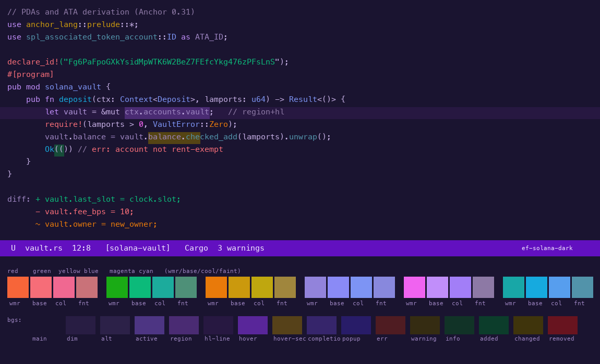
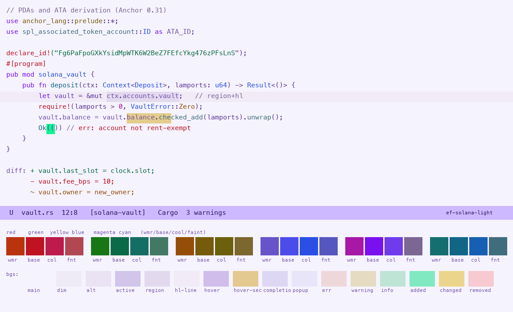

# solana-themes

Two legible GNU Emacs themes built around the official Solana brand
colors: `solana-dark` and `solana-light`.

| solana-dark | solana-light |
|---|---|
|  |  |

## Design

Solana's brand palette is built around two published colors
([solana.com/branding](https://solana.com/branding)):

- purple `#9945FF`
- green `#14F195`

The full brand set also includes dark, white, and secondary hues (see
the Solana Foundation brand materials), plus the signature
purple-to-green gradient.  Every hue in these themes is anchored to
the two published colors (magenta
family at ~268 degrees, green family at ~158 degrees).  The exact
brand hexes are used verbatim where contrast permits: the cursor in
both themes, the light theme's paren-match and `bg-green-intense`.

Contrast policy: every text/background pair meets WCAG AA (>= 4.5:1).
Lightness values were solved numerically per pair rather than picked by
eye; the measured tables are in the theme files' palette comments.
Headings cycle along the signature Solana gradient: purple at level 1,
three mid-tones (indigo, azure, teal) to green at level 5, then back
through the same mid-tones; the cycle restarts on purple.
Syntax roles are assigned for maximum hue separation (purple keywords,
green strings, teal function names, indigo types, gold builtins, rose
constants, neutral variables, recessive comments).

## Requirements

- GNU Emacs 28.1+
- [modus-themes](https://protesilaos.com/emacs/modus-themes) 5.0.0+
  (provides the face engine and user options these themes build on)

## Install

With `straight.el` and `use-package`:

```elisp
(use-package solana-themes
  :straight (:host github :repo "tilacog/solana-themes"))
```

With the built-in `package-vc` (Emacs 29+):

```
M-x package-vc-install RET https://github.com/tilacog/solana-themes
```

Or manually: clone this repository anywhere, add it to `load-path`,
then `(require 'solana-themes)`.

## Usage

```elisp
(load-theme 'solana-dark t)     ; or 'solana-light
```

Or interactively: `M-x solana-themes-select`, `solana-themes-toggle`,
`solana-themes-load-random`, `solana-themes-list-colors`, ...  (the
same command set as ef-themes, scoped to this family).  For the
generic Modus commands to consider only these themes, enable
`modus-themes-include-derivatives-mode`.

To toggle between the two:

```elisp
(setq modus-themes-to-toggle '(solana-light solana-dark))
```

To adjust individual palette entries:

```elisp
(setq solana-dark-palette-overrides
      '((cursor "#14F195")        ; the defaults already do this
        (bg-main "#120e20")))
```

Shared overrides for both themes go in
`solana-themes-common-palette-overrides` (an alias of
`modus-themes-common-palette-overrides`).

## Note

This project is not affiliated with, endorsed by, or connected to the
Solana Foundation.  The name references the color palette only.

## License

GPL-3.0-or-later.  See [LICENSE](LICENSE).  Palette mapping structure
adapted from `ef-themes` by Protesilaos Stavrou (GPL-3.0+).
